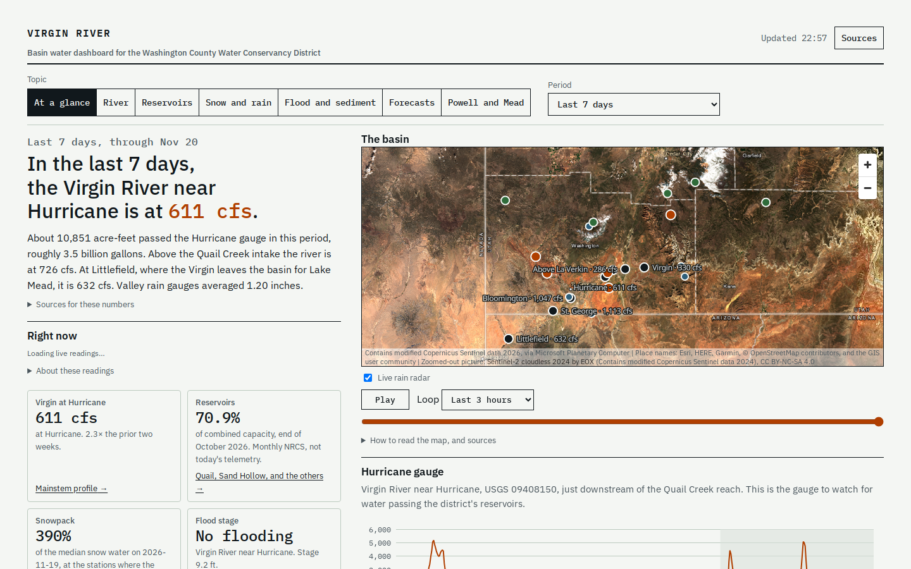
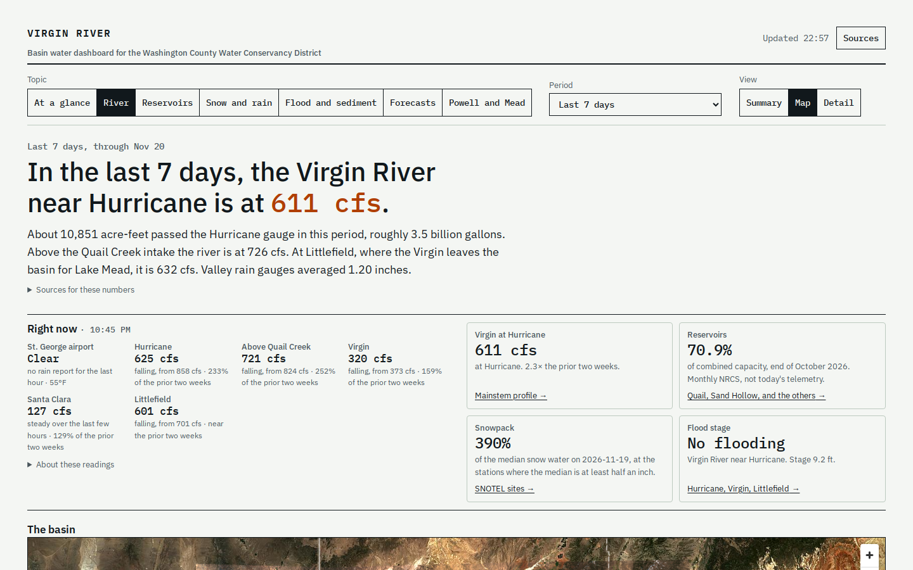
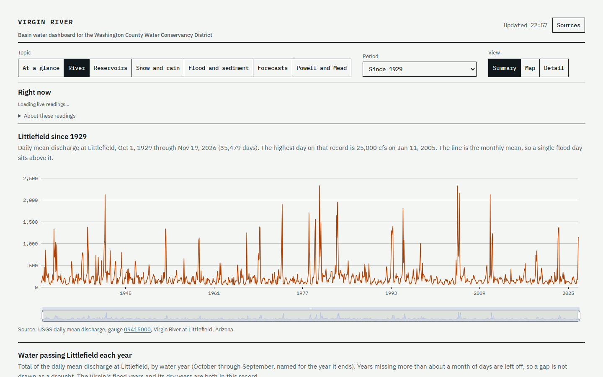

# Virgin River basin water dashboard

A water picture of the Virgin River for the [Washington County Water Conservancy District](https://www.wcwcd.gov/): mainstem and tributary flow, the five reservoirs the District watches, snowpack, rain, flood stage and turbidity, the Colorado Basin River Forecast Center's Virgin forecasts, and Lake Powell and Lake Mead as Colorado River context.

The figures are public federal data. They are not WCWCD's internal telemetry. Reservoir storage, in particular, is the NRCS end-of-month value. Daily District telemetry is not connected; the reservoirs panel is built so a daily series can sit beside the monthly record later.

**Based on [Clinton Lunn's gsl-dashboard](https://github.com/clintonlunn/gsl-dashboard).** Reused with his permission. The server, the plug-in sources, the page, and the Pages workflow started there and were retargeted from Great Salt Lake to the Virgin River. See `LICENSE`.

## Run it

Python 3.12 and [DuckDB](https://duckdb.org/) 1.4.3. Nothing else for the app itself.

```bash
pip install -r requirements.txt
python3 server.py
```

Open http://127.0.0.1:8765. The first launch pulls the Littlefield daily record back to 1929 and the other gauges back to 1980, so it takes a few minutes. After that, an hourly refresh only asks for what is new. The database is `virgin.duckdb` in this directory (gitignored). Override the path with `VIRGIN_DB`.

A static copy, the same one GitHub Pages publishes:

```bash
python3 server.py --export _site
```

`_site` has no server. It contains the preset periods (7 days, 30 days, 1 year, 10 years, and recent rain events) plus the Since 1929 record. Other dates need the local server.

## What the page shows

The basin is HUC **15010008** (Upper Virgin), **15010009** (Fort Pearce Wash), and **15010010** (Lower Virgin). The map opens on about **[-114.1, 36.85, -112.5, 37.65]**.

Mainstem gauges are one river sampled along its length, upstream to downstream. They are not volumes to add.

| USGS | Gauge | Role |
|---|---|---|
| 09405500 | North Fork Virgin River near Springdale | Tributary |
| 09404900 | East Fork Virgin River near Springdale | Tributary |
| 09406000 | Virgin River at Virgin | Mainstem |
| 09406100 | Virgin River above La Verkin Creek near La Verkin | Mainstem |
| 09408135 | Virgin River above Quail Creek near Hurricane | Mainstem, above the Quail Creek intake |
| 09408150 | Virgin River near Hurricane | Mainstem, the operations gauge |
| 09408400 | Santa Clara River near Pine Valley | Tributary |
| 09408195 | Fort Pearce Wash near St. George | Tributary |
| 09413000 | Santa Clara River at St. George | Tributary |
| 09413200 | Virgin River near Bloomington | Mainstem |
| 09413500 | Virgin River near St. George | Mainstem |
| 09415000 | Virgin River at Littlefield, Arizona | Mainstem, basin outlet, daily since 1929 |

Periods up to two months use 15-minute USGS readings averaged by hour. Longer periods use daily means. "Prior two weeks" is the median of the 14 days before the period, and that comparison is only drawn for the shorter periods. Acre-feet equal cfs times hours, divided by 12.1 (one cfs for a day is about 1.98 acre-feet).

**Reservoirs** are NRCS AWDB element RESC, monthly. Daily RESC is not published for these stations (a daily request comes back empty). Capacities are from station metadata, checked 2026-11-20: Quail Creek 40,000 acre-feet, Sand Hollow 50,000, Gunlock 10,400, Kolob 5,600, Ivins 1,418.

**Snow** is SNOTEL snow water equivalent, daily, with the NRCS daily median: 561 Kolob, 853 Webster Flat, 593 Long Valley Junction, 1066 Gardner Peak, 1065 Gutz Peak (all `UT:SNTL`). The basin percent is the sum of snow water divided by the sum of medians, and only for stations whose median that day is at least half an inch.

**Rain** is NOAA ACIS `MultiStnData` inside the basin box. The valley median uses stations below 5,000 feet that reported nearly every day. Mountain stations are shown and left out of the median.

**Flood and sediment** is NWS flood category at HURU1 (Hurricane), VIRU1 (Virgin), and VLTA3 (Littlefield), from `https://api.water.noaa.gov/nwps/v1/gauges/{lid}`, plus USGS turbidity (parameter 63680, FNU) at 09406000 and 09408400.

**Forecasts** are CBRFC area `VG`: the official April–July water-supply volume (thousand acre-feet) and the short-range flow forecast at HURU1. In the fall there is no new official issue until January; the page keeps the last one and says so.

**Powell and Mead** are USBR hydrodata CSVs. Powell is reservoir 919, parameters 49 (pool elevation) and 17 (storage). Mead is reservoir 921, the same two parameters. The Virgin enters Lake Mead; Powell is upstream on the Colorado. Percent full uses 23.314 million acre-feet for Powell (USBR total live storage at 3,700 ft) and 26.12 million acre-feet for Mead (a published active capacity near 1,220 ft). The acre-feet themselves are unscaled. If a hydrodata file fails, the same series is read from USBR RISE (Powell items 508 and 509, Mead items 6123 and 6124).

The map draws those gauges, reservoirs, and snow stations on Sentinel-2 imagery, with NWS NEXRAD radar from the Iowa Environmental Mesonet.

## How it is built

`server.py` is a stdlib `http.server` plus DuckDB. Plug-in sources live in `sources/` (`init`, `refresh`, `query`, `history`) and pair with `static/panels/<name>.js`. The page is vanilla ES modules, ECharts, and MapLibre. `python3 server.py --export _site` writes a server-free site.

`.github/workflows/pages.yml` rebuilds that site hourly, keeps `virgin.duckdb` in the Actions cache, runs `tests/smoke.py` (Playwright plus axe-core, strict), and deploys with GitHub Pages.

Screenshots of the main views are in `docs/screenshots/`.







## Turn on GitHub Pages

The workflow is in the repo. Pages will not publish until GitHub is pointed at it:

1. On GitHub, open **Settings → Pages** for this repository.
2. Under **Build and deployment**, set **Source** to **GitHub Actions**.
3. The first push to `main` (or a manual run of "Publish to GitHub Pages") builds `_site` and deploys it. The job needs the `github-pages` environment, which GitHub creates when Pages is set to Actions.
4. The site will be at `https://lance-weaver.github.io/virgin-river-dashboard/`.

Until that setting is changed, the Actions run can build and test, and the deploy job will wait or fail for lack of a Pages environment. Nothing else in the repository has to change.

## Not in this version

Canal diversions (Utah Division of Water Rights), points of diversion, land use, and open-water evaporation. Those were the second wave and are named in the page's method note so they are not mistaken for a gap in the river itself. Daily WCWCD reservoir telemetry is the other open slot.

## License

[MIT](LICENSE). Copyright 2026 Lance Weaver. Derived from Clinton Lunn's gsl-dashboard, used with his permission.
